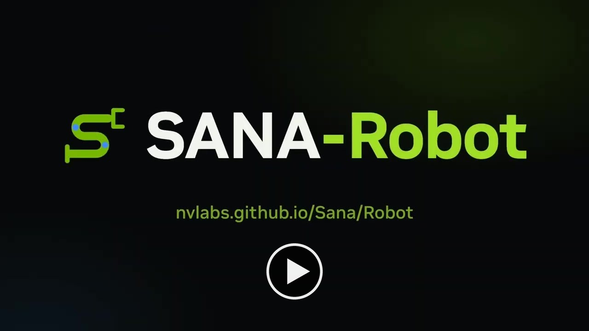
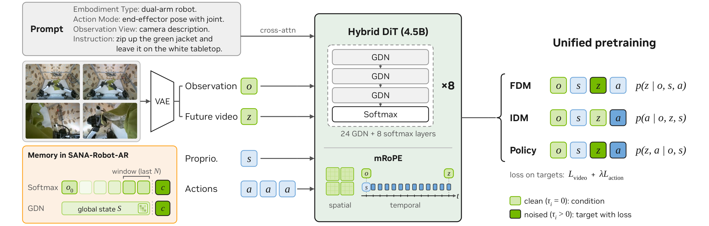
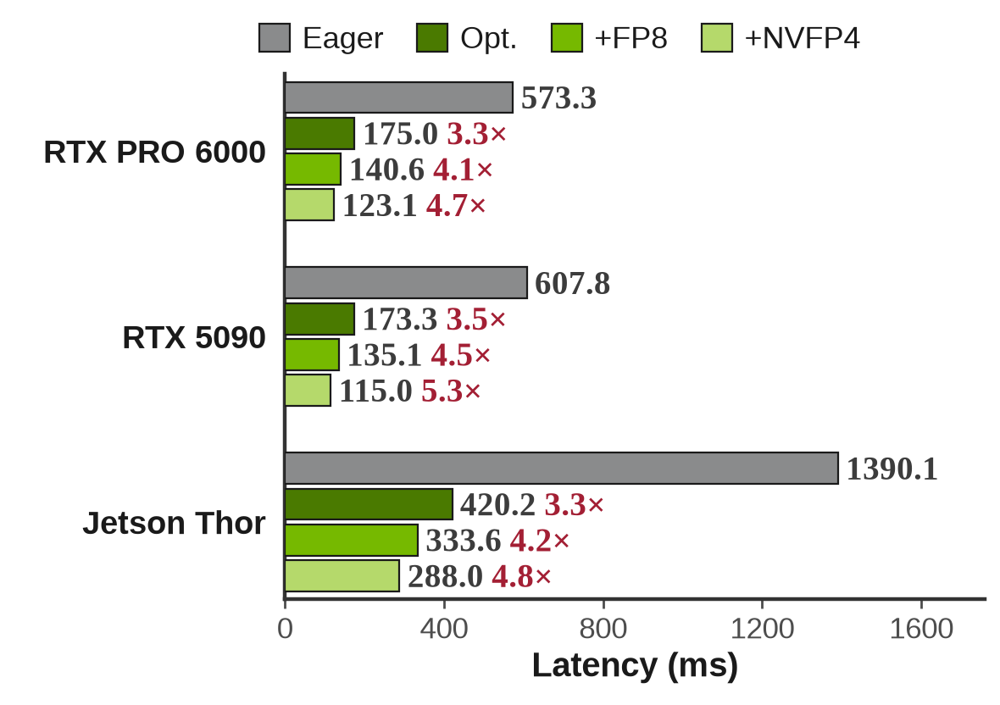
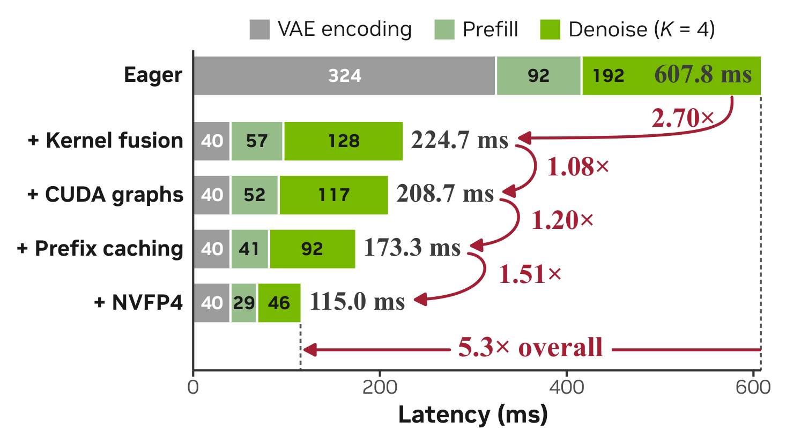

<p align="center" style="border-radius: 10px">
  <picture>
    <source media="(prefers-color-scheme: dark)" srcset="asset/logo_dark.png">
    
  </picture>
</p>

# 🤖 SANA-Robot: Efficient World Action Model with Hybrid Memory

<div align="center">
  <a href="https://nvlabs.github.io/Sana/Robot/"></a> &ensp;
  <a href="https://arxiv.org/abs/2611.28943"></a> &ensp;
  <a href="https://huggingface.co/collections/Efficient-Large-Model/sana-robot"></a> &ensp;
</div>

<p align="center" border-radius="10px">
  <a href="https://youtu.be/Q1jVVNz2BM0">
    
  </a>
</p>

## 🔥🔥 News

- [2026/11] Finetuning and inference code of SANA-Robot is released.

## 💡 Introduction

SANA-Robot is a 4.5B world action model trained from Sana-Video 2 that keeps a minute-level memory and runs in
real time on edge devices.

- 🌍 **Unified world action model**: with different noise levels on video and action tokens, one model serves as
  a policy, a forward dynamics model (a world simulator) and an inverse dynamics model.
- 🧠 **Hybrid memory at constant cost**: Gated DeltaNet layers compress every past chunk into a fixed-size state,
  and softmax layers attend to the first frame and a sliding window over the last chunks, so an action chunk
  costs the same however long the episode runs.
- ⚡ **Full-stack infrastructure**: sequence packing with task-balanced ordering trains on whole episodes without
  padding, memory RTC executes a policy with memory asynchronously, and fused kernels, CUDA graphs, prefix
  caching and low-bit GEMMs reduce the latency by 5.3×.

<p align="center" border-raduis="10px">
  
</p>

## Performance

Simulation benchmarks, SANA-Robot-AR post-trained from the pretrained model on each benchmark. RoboDojo cells are
average score / success rate (%); the others are success rates (%). Baseline numbers and the full tables are in
the paper.

| Methods           | RoboDojo Avg. 👆  | RoboDojo Memory 👆 | RoboTwin 2.0 Avg. / Clean / Rand. 👆 | LIBERO-Plus 👆 |
|-------------------|-------------------|--------------------|--------------------------------------|----------------|
| π<sub>0.5</sub>   | 11.44 / 6.93      | 5.89 / 4.67        | 60.5 / 73.1 / 47.9                   | 84.4           |
| OpenWAM-α         | 17.18 / 11.92     | 10.41 / 9.11       | 69.0 / 89.4 / 48.7                   | 69.2           |
| InternW0-Δ        | 30.77 / 23.91     | 34.67 / 34.00      | 81.0 / 90.0 / 71.9                   | 92.8           |
| **SANA-Robot-AR** | **34.31 / 27.09** | **52.73 / 52.33**  | **82.6 / 91.8 / 73.3**               | **94.0**       |

Per-request latency (ms) of SANA-Robot-AR in synchronous execution with 4 denoising steps and three camera
views: the sum of video encoding, prefill and denoising. Opt.: kernel fusion, CUDA graphs and prefix caching in
BF16; +FP8 and +NVFP4: with low-bit GEMMs.

<p align="center">
  
  
</p>

## Contents

- [Installation](#-1-installation)
- [Models](#-2-models)
- [Data Preparation](#-3-data-preparation)
- [Finetuning](#-4-finetune-sana-robot)
- [Simulation Evaluation](#-5-simulation-evaluation)
- [Real-World Deployment](#-6-real-world-deployment)
- [Citation](#bibtex)

# 🔧 1. Installation

- Linux x86_64 with an NVIDIA GPU
- Python 3.11 (Recommend to use [Miniconda](https://docs.conda.io/en/latest/miniconda.html))
- [PyTorch 2.9.1+cu128](https://pytorch.org/)

```bash
git clone -b robot https://github.com/NVlabs/Sana.git
cd Sana

# a new conda environment with Python 3.11 and the CUDA 12.8 toolkit
bash environment_setup.sh conda sana-robot
# or a virtual environment (needs python3.11 and a CUDA toolkit on the machine)
bash environment_setup.sh venv .venv
```

The script installs PyTorch, compiles `flash-attn` from source (about 40 minutes) and installs this package with
its pinned dependencies (see [pyproject.toml](pyproject.toml)).

# 📦 2. Models

| Model                      | Data                 | Recipe                                        | Link |
|----------------------------|----------------------|-----------------------------------------------|------|
| SANA-Robot-AR (pretrained) | pretraining mix      | -                                             | [SANA-Robot-AR-Pretrain](https://huggingface.co/Efficient-Large-Model/SANA-Robot-AR-Pretrain) |
| SANA-Robot-AR RoboDojo     | RoboDojo             | [robodojo_ar.yaml](configs/robodojo_ar.yaml) | [SANA-Robot-AR-RoboDojo](https://huggingface.co/Efficient-Large-Model/SANA-Robot-AR-RoboDojo) |
| SANA-Robot-AR RoboTwin 2.0 | RoboTwin 2.0 (clean) | [robotwin_ar.yaml](configs/robotwin_ar.yaml) | [SANA-Robot-AR-RoboTwin2.0](https://huggingface.co/Efficient-Large-Model/SANA-Robot-AR-RoboTwin2.0) |
| SANA-Robot-AR LIBERO       | LIBERO (four suites) | [libero_ar.yaml](configs/libero_ar.yaml)     | [SANA-Robot-AR-LIBERO](https://huggingface.co/Efficient-Large-Model/SANA-Robot-AR-LIBERO) |

All policies share two frozen models:

- **Video VAE**: the LTX-2.3 VAE in the diffusers layout (a directory with a `vae` subfolder):
  [LTX-2.3-Diffusers](https://huggingface.co/Efficient-Large-Model/LTX-2.3-Diffusers), of which only `vae/` is needed.
- **Text encoder**: [Gemma 2 2B](https://huggingface.co/google/gemma-2-2b-it)

The recipes and the examples below expect them under `checkpoints/`:

```
checkpoints/
├── LTX-2.3-Diffusers/vae/
├── gemma-2-2b-it/
└── sana_robot_ar_pretrain.pth
```

# 📂 3. Data Preparation

## 3.1 Dataset formats

Two dataset formats are supported:

- **Zip archive**: episodes packed in zip archives next to an index, the format the converters below write.
- **LeRobot** (v2.x or v3.0): read in place, with a mapping file from its columns to the robot fields
  (`data.lerobot_mapping`, see [lerobot.py](sana_robot/data/storage/lerobot.py)).

A zip archive dataset:

```
data/RoboDojo/sana_robot_zip/
├── meta.json          # control frequency, embodiment, action mode, cameras, robot fields in use
├── episodes.jsonl     # one episode per line: name, task, rows, instructions, archive
└── chunks/chunk-000000.zip
    ├── <episode>/rows.npz               # state and action [T, 80]: the state of every row and its absolute target
    └── <episode>/videos/<camera>.mp4    # one frame per row
```

A dataset comes with a normalization file: robot states and actions are normalized by the 1% and 99% quantiles of
the dataset.

```bash
python -m sana_robot.data.utils.compute_normalization --dataset data/MyRobot/sana_robot_zip --output data/MyRobot/normalization.json
```

## 3.2 RoboDojo, RoboTwin 2.0 and LIBERO

Each script converts the public release of a benchmark into a zip archive dataset and writes its normalization
file. For RoboDojo the script copies [robodojo_normalization.json](configs/robodojo_normalization.json), the
normalization the released checkpoint was trained with: it was computed from one sampled window per episode, and
`compute_normalization` on all rows of the dataset gives slightly different values.

```bash
# RoboDojo: the official LeRobot v3.0 release (RoboDojo_lerobot_v30_video)
bash scripts/data/convert_robodojo.sh /path/to/RoboDojo_lerobot_v30_video data/RoboDojo

# RoboTwin 2.0: the LeRobot v2.1 release yuanty/robotwin2.0-fastwam (clean scenes by default)
bash scripts/data/convert_robotwin.sh /path/to/robotwin2.0 data/RoboTwin

# LIBERO: the RLDS release openvla/modified_libero_rlds (four suites without no-op rows)
bash scripts/data/convert_libero.sh /path/to/modified_libero_rlds data/LIBERO
```

# 🔥 4. Finetune SANA-Robot

## 💰Hardware requirement

- SANA-Robot-AR is finetuned on whole episodes. `data.chunk_budget` is the number of action chunks one GPU holds
  per step and sets the memory: with the RoboDojo views, an 80 GB GPU (H100) holds 112 chunks (68 GB).
- Our training hardware is nodes of 8 H100 GPUs (80 GB), and the recipes are written for it: 8 nodes for RoboDojo,
  4 nodes for RoboTwin 2.0 and 2 nodes for LIBERO. On another number of GPUs, change `data.chunk_budget` so that
  a step trains the same number of chunks.

## 4.1 Finetune from a recipe

| Benchmark    | Recipe                                        | Nodes × GPUs | `data.chunk_budget` | Chunks per step |
|--------------|-----------------------------------------------|--------------|---------------------|-----------------|
| RoboDojo     | [robodojo_ar.yaml](configs/robodojo_ar.yaml) | 8 × 8        | 71                  | 4,541           |
| RoboTwin 2.0 | [robotwin_ar.yaml](configs/robotwin_ar.yaml) | 4 × 8        | 15                  | 486             |
| LIBERO       | [libero_ar.yaml](configs/libero_ar.yaml)     | 2 × 8        | 12                  | 177             |

An episode longer than the chunk budget takes a GPU alone, which is why a step of RoboTwin 2.0 trains a few more
chunks than its budget times 32.

```bash
# on every node, with the address of the first node (--nnodes 4 for RoboTwin 2.0, --nnodes 2 for LIBERO)
torchrun --nnodes 8 --nproc_per_node 8 --rdzv_id 1 --rdzv_backend c10d --rdzv_endpoint <first node>:29500 \
    -m sana_robot.train.train_ar --config_path configs/robodojo_ar.yaml

# one node of 8 GPUs, with the chunk budget that keeps the chunks of a step
bash scripts/train/train_ar.sh configs/libero_ar.yaml --data.chunk_budget 22
```

Every field of a recipe can be set on the command line. `train_ar.sh` starts one node, with `GPUS` GPUs. The
parameters are sharded inside a node and replicated across nodes, so the memory per GPU does not depend on the
number of nodes.

To speed up training, the video latents of a dataset can be encoded once and read instead of the frames (image
augmentation is then not available):

```bash
bash scripts/data/build_robodojo_latents.sh data/RoboDojo checkpoints/LTX-2.3-Diffusers
bash scripts/train/train_ar.sh configs/robodojo_ar.yaml --data.latent_store data/RoboDojo/latents
```

# 📊 5. Simulation Evaluation

The closed-loop evaluation of every benchmark is in its own directory under [eval](eval), with a README on how
to run it:

- [LIBERO](eval/libero/README.md): LIBERO-Plus, LIBERO-PRO and LIBERO-MAX.
- [RoboTwin 2.0](eval/robotwin/README.md): the clean and randomized settings.
- [RoboDojo](eval/robodojo/README.md): the policy adapter for RoboDojo's XPolicyLab.

# 💻 6. Real-World Deployment

## 💰Hardware requirement

- The optimized path has inference kernels for H100, RTX 5090, RTX PRO 6000 and Jetson Thor. Other GPUs run the
  plain PyTorch path.
- On one H100 with BF16 and 4 denoising steps on three views of 256×320, a request takes 79 ms.

A deployment is described by one config file. It names the policy and its weights, and the dataset the policy
was trained on, whose description gives the control frequency, the cameras and the robot fields. A released
checkpoint comes with that description (`meta.json`) and with the normalization it was trained with, so its
directory stands in for the dataset:

```yaml
policy_type: ar
checkpoint: checkpoints/sana_robot_ar_robodojo/sana_robot_ar_robodojo.pth
vae: checkpoints/LTX-2.3-Diffusers
text_encoder: checkpoints/gemma-2-2b-it
policy:
  spatial_layout: t_shape
  actions_per_chunk: 32
  sliding_window_chunks: 1
dataset: checkpoints/sana_robot_ar_robodojo
normalization: checkpoints/sana_robot_ar_robodojo/normalization.json
view_sizes: [[384, 480], [192, 256], [192, 256]]
chunk_size: 32
video_frame_stride: 4
steps: 4
```

Every field can also be set on the command line, e.g. `--steps 2`. For a policy you finetuned, name the dataset it
was trained on and the normalization file of that dataset.

## 6.1 Client-server deployment

The policy runs in a server on the GPU machine. The robot's control loop is a client on the robot's machine,
which needs only NumPy and OpenCV:

```bash
# GPU machine: load the policy and wait for the robot
bash scripts/deploy/server.sh my_deploy.yaml --host 0.0.0.0 --port 8000

# robot machine: the control loop of your robot
python sana_robot/deploy/client.py --host <GPU machine> --port 8000 --instruction "put the red block into the box"
```

[client.py](sana_robot/deploy/client.py) is a template: fill in `Robot.read`, which returns the camera frames and
the robot state, and `Robot.send`, which takes the command of one control step. With `--async_delay_steps d` the
server generates the next chunk while the robot runs `d` more control steps of the running one. See the
[deployment README](sana_robot/deploy/README.md) for the interface, the conversion of your robot's state and
commands, and asynchronous execution, and the [YAM example](sana_robot/deploy/yam/README.md) for a complete
robot side: two YAM arms with RealSense cameras.

## 6.2 Latency benchmark

```bash
# kernels, CUDA graphs and prefix caching
bash scripts/deploy/benchmark.sh my_deploy.yaml
# plain PyTorch
bash scripts/deploy/benchmark.sh my_deploy.yaml --optimized false
```

## 6.3 Optimized inference

`optimized: true` (the default) installs the inference kernels of the GPU on the policy, runs the policy and the
video encoder as CUDA graphs and compiles the video encoder. `precision` selects the precision of the large matrix
products:

| `precision` | GEMMs                               | GPUs                                      |
|-------------|-------------------------------------|-------------------------------------------|
| `bf16`      | BF16 (default)                      | H100, RTX 5090, RTX PRO 6000, Jetson Thor |
| `fp8`       | FP8 (E4M3)                          | H100, RTX 5090, RTX PRO 6000, Jetson Thor |
| `nvfp4`     | NVFP4 (E2M1 with E4M3 block scales) | RTX 5090, RTX PRO 6000, Jetson Thor       |

```bash
bash scripts/deploy/benchmark.sh my_deploy.yaml --precision fp8
```

# Acknowledgements

**Thanks to the following open-sourced codebases and benchmarks for their wonderful work and data!**

- [diffusers](https://github.com/huggingface/diffusers)
- [LeRobot](https://github.com/huggingface/lerobot)
- [RoboDojo](https://github.com/robodojo-benchmark/RoboDojo)
- [RoboTwin 2.0](https://github.com/RoboTwin-Platform/RoboTwin)
- [LIBERO](https://github.com/Lifelong-Robot-Learning/LIBERO)

# License

This project is released under the [Apache 2.0 license](LICENSE).

# 📖BibTeX

```
@article{zhao2026sanarobot,
  title={SANA-Robot: Efficient World Action Model with Hybrid Memory},
  author={Zhao, Yuyang and Li, Zekai and Pan, Yicheng and Tang, Jiaming and Zhang, Zhuoyang and Xing, Jiaxu and Reuss, Moritz and Peng, Quanquan and Chen, Junsong and Xie, Enze and Liu, Zhijian and Han, Song},
  journal={arXiv preprint arXiv:2611.28943},
  year={2026}
}
```
