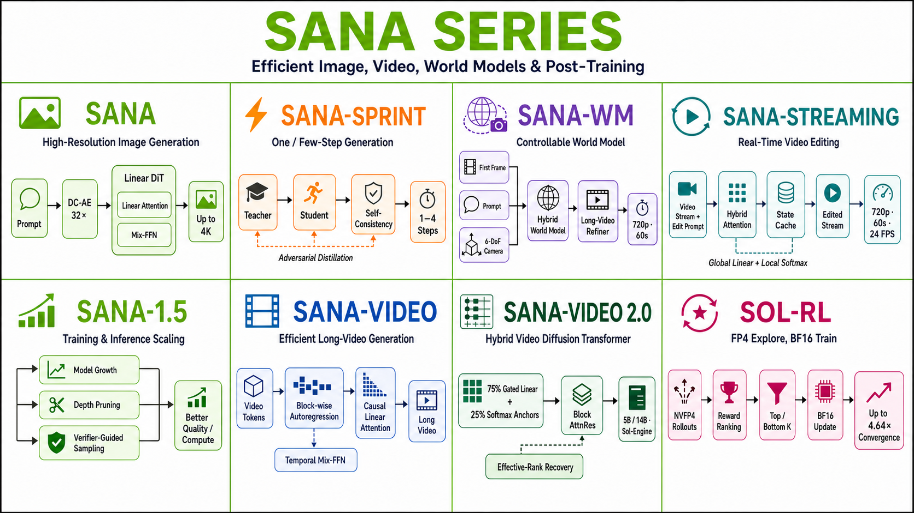
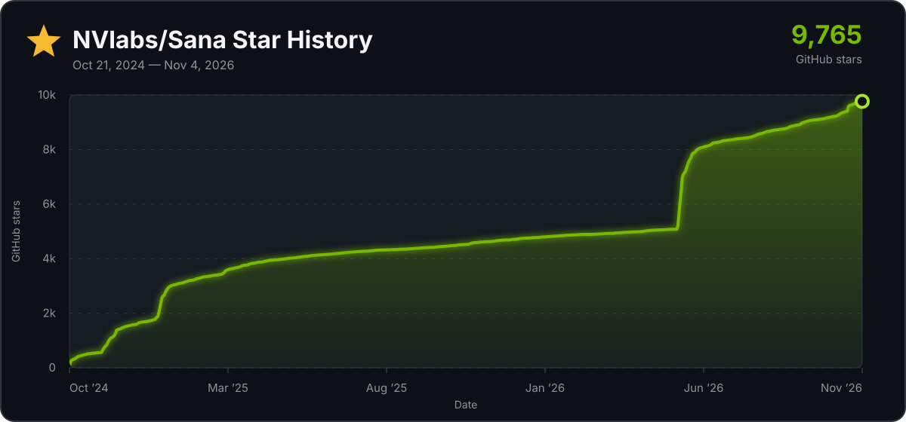

<p align="center" style="border-radius: 10px">
  
</p>

<h3 align="center">
<a href="https://nvlabs.github.io/Sana/docs/"><b>📚 官方文档</b></a> | <a href="https://nvlabs.github.io/Sana/"><b>SANA</b></a> | <a href="https://nvlabs.github.io/Sana/Sana-1.5/"><b>SANA-1.5</b></a> | <a href="https://nvlabs.github.io/Sana/Sprint/"><b>SANA-Sprint</b></a> | <a href="https://nvlabs.github.io/Sana/Video/"><b>SANA-Video</b></a> | <a href="https://nvlabs.github.io/Sana/Video2/"><b>SANA-Video 2.0</b></a> | <a href="https://nvlabs.github.io/Sana/WM/"><b>SANA-WM</b></a> | <a href="https://nvlabs.github.io/Sana/Streaming/"><b>SANA-Streaming</b></a> | <a href="https://nvlabs.github.io/Sana/Sol-RL/"><b>Sol-RL</b></a>

<a href="https://nv-sana.mit.edu/"><b>在线演示</b></a> | <a href="https://huggingface.co/spaces/Efficient-Large-Model/sana-video2-5b-720p-demo"><b>🎬 SANA-Video 2.0 演示</b></a> | <a href="https://huggingface.co/collections/Efficient-Large-Model/sana"><b>🤗 HuggingFace</b></a> | <a href="https://github.com/lawrence-cj/ComfyUI_ExtraModels"><b>ComfyUI</b></a> | <a href="https://github.com/sgl-project/sglang"><b>SGLang</b></a> | <a href="https://github.com/nvidia-cosmos/cosmos-rl/blob/main/examples/sana.md"><b>Cosmos-RL</b></a>

</h3>

<p align="center">
  <a href="https://github.com/NVlabs/Sana/blob/main/README.md">English</a> · <b>简体中文</b>
</p>

<p align="center">
  <a href="https://nv-sana.mit.edu/"></a> &ensp;
  <a href="https://nv-sana.mit.edu/4bit/"></a> &ensp;
  <a href="https://nv-sana.mit.edu/ctrlnet/"></a> &ensp;
  <a href="https://nv-sana.mit.edu/sprint/"></a> &ensp;
  <a href="https://huggingface.co/spaces/Efficient-Large-Model/SanaSprint"></a> &ensp;
  <a href="https://huggingface.co/spaces/Efficient-Large-Model/sana-video2-5b-720p-demo"></a> &ensp;
</p>

<p align="center">
  <a href="https://replicate.com/chenxwh/sana"></a> &ensp;
  <a href="https://discord.gg/rde6eaE5Ta"></a> &ensp;
  <a href="https://sana-wm.reactor.inc/"></a> &ensp;
  <a href="https://sana-streaming.reactor.inc/"></a> &ensp;
</p>

<p align="center">
  <a href="https://github.com/NVlabs/Sana/tree/sol-engine">
    
  </a>
</p>

<h4 align="center">ICLR 2025 Oral | ICML 2025 | ICCV 2025 Highlight | ICLR 2026 Oral </h4>

**SANA** 是一个面向极致效率的高分辨率图像与视频生成代码库，提供端到端的完整训练与推理管线。本仓库包含 [SANA](https://nvlabs.github.io/Sana/)、[SANA-1.5](https://nvlabs.github.io/Sana/Sana-1.5/)、[SANA-Sprint](https://nvlabs.github.io/Sana/Sprint/)、[SANA-Video](https://nvlabs.github.io/Sana/Video/)、[SANA-Video 2.0](https://nvlabs.github.io/Sana/Video2/)、[SANA-WM](https://nvlabs.github.io/Sana/WM/)、[SANA-Streaming](https://nvlabs.github.io/Sana/Streaming/) 以及 [Sol-RL](https://nvlabs.github.io/Sana/Sol-RL/) 的核心代码。更多细节请参阅我们的 [📚 官方文档](https://nvlabs.github.io/Sana/docs/)。

欢迎加入我们的 [Discord](https://discord.gg/rde6eaE5Ta) 与社区展开技术探讨！如有任何疑问、遇到问题或希望为项目做出贡献，请随时与我们联系！

<p align="center" border-radius="10px">
  
</p>

## 最新动态 (News)

- 🔥 [2026/10] 🎮 **StreamRender-H3** 正式发布！一个代码驱动的流式渲染运行时，将可控的 Three.js 游戏引擎连接至多 GPU H3 流式渲染器，并提供浏览器端视频反馈。参见 [项目主页](https://nvlabs.github.io/Sana/Sol-Engine/StreamRender-H3/) | [代码](https://github.com/NVlabs/Sana/tree/sol-engine/models/streamrender_h3)。
- 🔥 [2026/10] ⚡ **Sol-H3** 将 MiniMax-H3 带入单张 RTX 5090 或 DGX Spark，现已支持 ComfyUI：在单张 RTX 5090 上生成带音频的 1344×768 片段仅需 **35.5 秒**（原始 50 步模型需 989.0 秒）。参见 [项目主页](https://nvlabs.github.io/Sana/Sol-H3/) | [代码](https://github.com/NVlabs/Sana/tree/sol-engine/models/minimax_h3)。
- 🔥 [2026/09] 🔍 **SoL-Refiner** 正式发布！单步精炼技术将低分辨率视频草稿转化为高清视频，提供针对 LTX-2.3 与 MiniMax-H3 的代码与模型权重。参见 [项目主页](https://nvlabs.github.io/Sana/Sol-Refiner/) | [代码](https://github.com/NVlabs/Sana/tree/sol-engine/models/sol-refiner)。
- 🔥 [2026/09] ⚡ **SANA-Video 2.0 5B 4-Step 预览版** 发布！DMD 预览版支持 4 步去噪生成 720p 视频，并支持 5 秒与 8 秒视频输出。参见 [在线演示](https://huggingface.co/spaces/Efficient-Large-Model/sana-video2-5b-720p-demo) | [4 步权重](https://huggingface.co/Efficient-Large-Model/SANA-Video_2.0_5B_720p_4step) | [文档](https://nvlabs.github.io/Sana/docs/sana_video2/) | [项目主页](https://nvlabs.github.io/Sana/Video2/)。
- 🔥 [2026/08] 🎬 **SANA-Video 2.0** 训练、推理、模型架构及 5B 720p 检查点正式发布！该 8 秒视频模型同时支持文生视频（T2V）与图文生视频（TI2V），配备混合线性/Softmax 注意力与注意力残差（Attention Residuals）。参见 [在线演示](https://huggingface.co/spaces/Efficient-Large-Model/sana-video2-5b-720p-demo) | [项目主页](https://nvlabs.github.io/Sana/Video2/) | [文档](https://nvlabs.github.io/Sana/docs/sana_video2/) | [模型库](https://nvlabs.github.io/Sana/docs/model_zoo/#sana-video-20) | [权重](https://huggingface.co/Efficient-Large-Model/SANA-Video_2.0_5B_720p)。
- 🔥 [2026/08] ⚡ **Sol Engine: MiniMax-H3 首发加速** 上线！33B 全模态音视频 DiT 在 GB200 上提速 **3.95×**（仅需 4.5 小时调优），在桌面级硬件上最高提速 **4.52×** —— DGX Spark 上提速 3.92×，GeForce RTX 5090 上提速 4.52× —— 且无需蒸馏、无需 LoRA、无需校准过程。参见 [GB200 博客](https://nvlabs.github.io/Sana/Sol-Engine/H3/) | [端侧硬件博客](https://nvlabs.github.io/Sana/Sol-Engine/H3-OnDevice/)。
- 🔥 [2026/07] 🌍 **SANA-Streaming** 训练代码发布！涵盖双向训练与蒸馏训练。参见 [文档](https://nvlabs.github.io/Sana/docs/sana_streaming/)。
- 🔥 [2026/07] 🌍 **SANA-WM** 阶段 1 训练代码发布！涵盖双向、分块因果与蒸馏训练。参见 [文档](https://nvlabs.github.io/Sana/docs/sana_wm/)。
- 🔥 [2026/06] 🎬 **SANA-Streaming: 2B 参数实时流式编辑模型** 正式发布！支持 720p 分辨率、1 分钟时长视频编辑，为流式视频编辑的开创性工作。参见 [项目主页](https://nvlabs.github.io/Sana/Streaming/) | [文档](https://nvlabs.github.io/Sana/docs/sana_streaming/) | [论文](https://huggingface.co/papers/2605.30409) | [Reactor 演示](https://sana-streaming.reactor.inc)。
- 🔥 [2026/05] 🌍 **SANA-WM: 2.6B 参数可控世界模型** 正式发布！支持 720p 分辨率、1 分钟视频生成与 6 自由度（6-DoF）相机控制，为世界模型与具身智能设立全新基准。参见 [项目主页](https://nvlabs.github.io/Sana/WM/) | [文档](https://nvlabs.github.io/Sana/docs/sana_wm/) | [论文](https://huggingface.co/papers/2605.15178) | [Reactor 演示](https://sana-wm.reactor.inc/)。
- 🔥 [2026/04] ⚡ **Sol-RL: NVFP4 采样 Rollout、BF16 训练优化 RL** 上线！提供针对 **SANA**、**FLUX.1** 与 **SD3.5-L** 的全套训练配方及打包的后训练数据集。参见 [Sol-RL 文档](https://nvlabs.github.io/Sana/docs/sol_rl/) | [主页](https://nvlabs.github.io/Sana/Sol-RL/) | [论文](https://arxiv.org/abs/2604.06916)。
- 🔥 [2026/03] 📺 **基于 LTX-VAE 的 SANA-Video 720p 模型** 发布。可搭配 LTX2 Refiner 将视频超分辨率放大至 2K 分辨率！参见 [模型库](https://nvlabs.github.io/Sana/docs/model_zoo/#sana-video)、[SANA-Video 文档](https://nvlabs.github.io/Sana/docs/sana_video/) 与 [Refiner 技术博客](https://nvlabs.github.io/Sana/Video/bet-small-win-big/blog.html)。
- 🔥 [2026/03] 💪 **后训练基础设施: SANA × Cosmos-RL** —— 我们与 [Cosmos-RL](https://github.com/nvidia-cosmos/cosmos-rl) 合作，为 SANA 提供完整的强化学习基础设施。现可利用前沿算法（如 Diffusion-NFT、Flow-GRPO）、预设配置、奖励服务及灵活数据集对 SANA-Image 和 SANA-Video 进行后训练（SFT/RL）。参见 [Cosmos-RL 上的 SANA](https://github.com/nvidia-cosmos/cosmos-rl/blob/main/examples/sana.md) 与我们的 [Cosmos-RL 集成文档](https://nvlabs.github.io/Sana/docs/sana_cosmos_rl/)。
- 🔥 [2026/02] 🚀 **SANA 现已获得 [SGLang](https://github.com/sgl-project/sglang) 支持！** 提供兼容 OpenAI API 的高性能推理服务。[[指南]](https://nvlabs.github.io/Sana/docs/sglang/)
- 🔥 [2026/01/26] **SANA-Video 被 ICLR 2026 接收为 Oral 论文报告。** 🎉🎉🎉
- 🔥 [2025/12/09] 🎬 [LongSANA](https://nvlabs.github.io/Sana/docs/longsana/)：27FPS 实时长视频生成模型（分钟级生成），训练与推理代码全量开源。特别鸣谢 [LongLive 团队](https://github.com/NVlabs/LongLive)。参考：[[训练指南]](https://nvlabs.github.io/Sana/docs/longsana/#how-to-train) | [[测试指南]](https://nvlabs.github.io/Sana/docs/longsana/#how-to-inference) | [[模型权重]](https://nvlabs.github.io/Sana/docs/model_zoo/#sana-video)
- 🔥 [2025/11/24] 🪶 [技术博客](https://hanlab.mit.edu/blog/infinite-context-length-with-global-but-constant-attention-memory)：因果线性注意力如何为大语言模型与长视频生成解锁无限上下文长度。
- 🔥 [2025/11/9] 🎬 [视频演示](https://www.youtube.com/watch?v=ztdkfIMkdJ4) 展示分块因果线性注意力与因果混合前馈网络（Causal Mix-FFN）的工作机制。
- 🔥 [2025/11/6] 📺 **SANA-Video** 已合入 [diffusers](https://huggingface.co/docs/diffusers/main/en/api/pipelines/sana_video)。[使用指南](https://nvlabs.github.io/Sana/docs/sana_video/#1-how-to-use-sana-video-pipelines-in-diffusers)。
- 🔥 [2025/10/27] 📺 **SANA-Video** 正式发布。[[说明文档]](https://nvlabs.github.io/Sana/docs/sana_video/) | [[模型权重]](https://nvlabs.github.io/Sana/docs/model_zoo/#sana-video) 支持文生视频（T2V）与图文生视频（TI2V）。
- 🔥 [2025/10/13] 📺 **SANA-Video** 即将上线：1). 5 秒线性 DiT 视频模型，以及 2). 实时分钟级长视频生成（结合 [LongLive](https://github.com/NVlabs/LongLive)）。[[论文]](https://www.arxiv.org/pdf/2509.24695) | [[项目主页]](https://nvlabs.github.io/Sana/Video/)

<details>
  <summary>点击查看全部历史更新</summary>

- ✅ [2025/8/20] 发布全新的 DC-AE-Lite，实现更快推理速度与更低显存占用。[[配置指南]](https://github.com/NVlabs/Sana/blob/main/configs/sana_sprint_config/1024ms/SanaSprint_1600M_1024px_allqknorm_bf16_scm_ladd_dc_ae_lite.yaml#L52) | [[diffusers PR]](https://github.com/huggingface/diffusers/pull/12169) | [[权重]](https://huggingface.co/mit-han-lab/dc-ae-lite-f32c32-sana-1.1-diffusers)
- ✅ [2025/6/25] [SANA-Sprint](https://nvlabs.github.io/Sana/Sprint/) 被 ICCV 2025 录用 🏖️
- ✅ [2025/6/4] 发布 SANA-Sprint [ComfyUI 节点](https://github.com/lawrence-cj/ComfyUI_ExtraModels) [[工作流示例]](docs/ComfyUI/SANA-Sprint.json)。
- ✅ [2025/5/8] SANA-Sprint（单步扩散）diffusers 训练代码发布 [[使用指南]](https://github.com/huggingface/diffusers/blob/main/examples/research_projects/sana/README.md)。
- ✅ [2025/5/4] **SANA-1.5（推理期计算扩展）被 ICML 2025 接收。** 🎉🎉🎉
- ✅ [2025/3/22] 🔥 **SANA-Sprint 在线 Demo 已上线 Huggingface，欢迎试用！** 🎉 [[演示链接]](https://huggingface.co/spaces/Efficient-Large-Model/SanaSprint)
- ✅ [2025/3/22] 🔥 **SANA-1.5 现已支持 ComfyUI！** 🎉：[ComfyUI 使用指南](https://nvlabs.github.io/Sana/docs/ComfyUI/comfyui/) | [ComfyUI SANA-1.5 4.8B 工作流](https://nvlabs.github.io/Sana/docs/ComfyUI/SANA-1.5_FlowEuler.json)
- ✅ [2025/3/22] 🔥 **SANA-Sprint 代码与权重全量发布！** 🎉 包含：[训练与推理代码](https://nvlabs.github.io/Sana/docs/sana_sprint/) 与 [模型权重](https://nvlabs.github.io/Sana/docs/model_zoo/#sana-sprint) / [HF 合集](https://huggingface.co/collections/Efficient-Large-Model/sana-sprint)。[[使用指南]](https://nvlabs.github.io/Sana/docs/sana_sprint/)
- ✅ [2025/3/21] 🚀 Sana + **推理计算扩展（Inference Scaling）** 发布。[[使用指南]](https://nvlabs.github.io/Sana/docs/inference_scaling/)
- ✅ [2025/3/16] 🔥 **SANA-1.5 代码与权重全量发布！** 🎉 包含：[DDP/FSDP](https://nvlabs.github.io/Sana/docs/sana/#training) | [TAR 格式 WebDataset](https://nvlabs.github.io/Sana/docs/sana/#multi-scale-webdataset) | [多尺度训练代码](https://nvlabs.github.io/Sana/docs/sana/#training-with-fsdp) 与 [模型权重](https://nvlabs.github.io/Sana/docs/model_zoo/#sana-15) / [HF 合集](https://huggingface.co/collections/Efficient-Large-Model/sana-15)。
- ✅ [2025/3/14] 🏃 **SANA-Sprint 预告发布！** 🎉 Sana 全新的单步/少步生成器。H100 上生成单张 1024px 图像仅需 0.1 秒，RTX 4090 仅需 0.3 秒。了解详情：[[项目主页]](https://nvlabs.github.io/Sana/Sprint/) | [[ArXiv 论文]](https://arxiv.org/abs/2503.09641)。代码将紧随 `diffusers` 发布。
- ✅ [2025/2/10] 🚀 Sana + ControlNet 发布。[[使用指南]](https://nvlabs.github.io/Sana/docs/sana_controlnet/) | [[模型]](https://nvlabs.github.io/Sana/docs/model_zoo/#sana) | [[在线演示]](https://nv-sana.mit.edu/ctrlnet/)
- ✅ [2025/1/30] 发布 CAME-8bit 优化器代码，训练过程中节省更多 GPU 显存。[[配置方法]](https://github.com/NVlabs/Sana/blob/main/configs/sana_config/1024ms/Sana_1600M_img1024_CAME8bit.yaml#L86)
- ✅ [2025/1/29] 🎉 🎉 🎉 **SANA 1.5 正式上线！探索如何进行高效训练与推理计算扩展！** 🚀 [[技术报告]](https://arxiv.org/abs/2501.18427)
- ✅ [2025/1/24] 4bit-Sana 发布，由 [SVDQuant 与 Nunchaku](https://github.com/mit-han-lab/nunchaku) 推理引擎驱动。现在仅需 **8GB** GPU 显存即可运行 Sana [[使用指南]](https://nvlabs.github.io/Sana/docs/4bit_sana/) [[在线演示]](https://svdquant.mit.edu/) [[模型]](https://nvlabs.github.io/Sana/docs/model_zoo/#sana)
- ✅ [2025/1/24] DCAE-1.1 发布，重建质量大幅提升。[[模型]](https://huggingface.co/mit-han-lab/dc-ae-f32c32-sana-1.1) [[diffusers]](https://huggingface.co/mit-han-lab/dc-ae-f32c32-sana-1.1-diffusers)
- ✅ [2025/1/23] **Sana 被 ICLR 2025 接收为 Oral 论文报告。** 🎉🎉🎉
- ✅ [2025/1/12] DC-AE 分块（Tiling）使 Sana-4K 能够在 22GB 显存内推理 4096×4096px 图像。结合模型卸载与 8bit/4bit 量化，4K Sana 可在 **8GB** 显存内流畅运行。[[指南]](https://nvlabs.github.io/Sana/docs/model_zoo/#3-2k-4k-models)
- ✅ [2025/1/11] Sana 代码库开源协议变更为 Apache 2.0。
- ✅ [2025/1/10] 支持 8bit 量化推理 Sana。[[指南]](https://nvlabs.github.io/Sana/docs/8bit_sana/#quantization)
- ✅ [2025/1/8] [Sana-ComfyUI](https://github.com/lawrence-cj/ComfyUI_ExtraModels) 支持 4K 分辨率 [Sana 模型](https://nvlabs.github.io/Sana/docs/model_zoo/#sana)，并提供配套[工作流文件](https://nvlabs.github.io/Sana/docs/ComfyUI/Sana_FlowEuler_4K.json)。[[4K 指南]](https://nvlabs.github.io/Sana/docs/ComfyUI/comfyui/#a-sample-workflow-for-sana-4096x4096-image-18gb-gpu-is-needed)
- ✅ [2025/1/8] 1.6B 4K 分辨率 [Sana 模型](https://nvlabs.github.io/Sana/docs/model_zoo/#sana) 发布：[[BF16 pth]](https://huggingface.co/Efficient-Large-Model/Sana_1600M_4Kpx_BF16) 或 [[BF16 diffusers]](https://huggingface.co/Efficient-Large-Model/Sana_1600M_4Kpx_BF16_diffusers)。🚀 20 秒内生成 4096×4096 分辨率图像！在 [Sana 项目主页](https://nvlabs.github.io/Sana/) 查看更多示例。感谢 [SUPIR](https://github.com/Fanghua-Yu/SUPIR) 的杰出工作与支持。
- ✅ [2025/1/2] 修复 `diffusers` 管线中的已知缺陷。[PR 记录](https://github.com/huggingface/diffusers/pull/10431)
- ✅ [2025/1/2] [Sana-ComfyUI](https://github.com/lawrence-cj/ComfyUI_ExtraModels) 支持 2K 分辨率 [Sana 模型](asset/docs/model_zoo.md)，并提供配套[工作流文件](asset/docs/ComfyUI/Sana_FlowEuler_2K.json)。
- ✅ [2024/12] 1.6B 2K 分辨率 [Sana 模型](asset/docs/model_zoo.md) 发布：[[BF16 pth]](https://huggingface.co/Efficient-Large-Model/Sana_1600M_2Kpx_BF16) 或 [[BF16 diffusers]](https://huggingface.co/Efficient-Large-Model/Sana_1600M_2Kpx_BF16_diffusers)。🚀 4 秒内生成 2K 分辨率图像！在 [Sana 项目主页](https://nvlabs.github.io/Sana/) 查看更多示例。感谢 [SUPIR](https://github.com/Fanghua-Yu/SUPIR) 的杰出工作与支持。
- ✅ [2024/12] `diffusers` 支持 Sana-LoRA 微调！Sana-LoRA 的训练与收敛速度极其迅速。[[指南]](https://nvlabs.github.io/Sana/docs/sana_lora_dreambooth/) 或 [[diffusers 文档]](https://github.com/huggingface/diffusers/blob/main/examples/dreambooth/README_sana.md)。
- ✅ [2024/12] `diffusers` 正式集成 Sana！全套 [Sana diffusers safetensors 模型](https://huggingface.co/collections/Efficient-Large-Model/sana) 发布，现已支持 `SanaPipeline`、`SanaPAGPipeline` 与 `DPMSolverMultistepScheduler(FlowMatching)` 管线。欢迎查看我们准备的[模型卡片](https://nvlabs.github.io/Sana/docs/model_zoo/#sana)。
- ✅ [2024/12] 1.6B BF16 [Sana 模型](https://huggingface.co/Efficient-Large-Model/Sana_1600M_1024px_BF16) 发布，用于稳定微调。
- ✅ [2024/12] 发布针对 Sana 的 [ComfyUI 节点](https://github.com/lawrence-cj/ComfyUI_ExtraModels)。[[使用指南]](https://nvlabs.github.io/Sana/docs/ComfyUI/comfyui/)
- ✅ [2024/11] 发布全套多语言（Emoji、中文与英文）SFT 模型：[1.6B-512px](https://huggingface.co/Efficient-Large-Model/Sana_1600M_512px_MultiLing)、[1.6B-1024px](https://huggingface.co/Efficient-Large-Model/Sana_1600M_1024px_MultiLing)、[600M-512px](https://huggingface.co/Efficient-Large-Model/Sana_600M_512px)、[600M-1024px](https://huggingface.co/Efficient-Large-Model/Sana_600M_1024px)。评测指标请见[性能基准](#性能基准-performance)。
- ✅ [2024/11] Sana Replicate API 在 [Sana-API](https://replicate.com/chenxwh/sana) 上线。
- ✅ [2024/11] 1.6B [Sana 模型系列](https://huggingface.co/collections/Efficient-Large-Model/sana) 发布。
- ✅ [2024/11] 训练、推理与评测代码全量开源。
- ✅ [2024/11] 推进 [`diffusers`](https://github.com/huggingface/diffusers/pull/9982) 官方集成。
- [2024/10] [在线演示](https://nv-sana.mit.edu/) 上线。
- [2024/10] [DC-AE 代码](https://github.com/mit-han-lab/efficientvit/blob/master/applications/dc_ae/README.md) 与 [模型权重](https://huggingface.co/collections/mit-han-lab/dc-ae) 发布！
- [2024/10] [论文](https://arxiv.org/abs/2410.10629) 上线 Arxiv！

</details>

## 💡 项目简介 (Introduction)

我们隆重推出 **SANA**，一系列面向高分辨率图像与视频生成的高效扩散模型体系：

- **[SANA](https://nvlabs.github.io/Sana/)**：支持最高 4K 分辨率的文本到图像生成，相比 Flux-12B **体积小 20 倍，速度快 100 倍**。
- **[SANA-1.5](https://nvlabs.github.io/Sana/Sana-1.5/)**：高效的训练期与推理期计算扩展（Compute Scaling），带来更高的生成质量。
- **[SANA-Sprint](https://nvlabs.github.io/Sana/Sprint/)**：通过 sCM 蒸馏实现的单步/少步生成，在 H100 上生成 1024px 图像仅需 **0.1 秒**。
- **[SANA-Video/LongSANA](https://nvlabs.github.io/Sana/Video/)**：结合分块线性注意力（Block Linear Attention）/ 与 [LongLive](https://github.com/NVlabs/LongLive) 协同的高效视频生成。
- **[SANA-Video 2.0](https://nvlabs.github.io/Sana/Video2/)**：5B 与 14B 参数架构，支持文生视频与图文生视频，配备混合线性/Softmax 注意力机制与注意力残差（Attention Residuals）。欢迎试用 [5B 720p 4 步预览版](https://huggingface.co/spaces/Efficient-Large-Model/sana-video2-5b-720p-demo)，或下载 [50 步标准版](https://huggingface.co/Efficient-Large-Model/SANA-Video_2.0_5B_720p) 与 [4 步预览版](https://huggingface.co/Efficient-Large-Model/SANA-Video_2.0_5B_720p_4step) 权重；14B 配置与权重暂未开放。
- **[Sol-RL](https://nvlabs.github.io/Sana/Sol-RL/)**：NVFP4 采样 Rollout、BF16 训练强化学习，实现 **4.64 倍更快的训练收敛**。
- **[SANA-WM](https://nvlabs.github.io/Sana/WM/)**：2.6B 参数的可控世界模型，支持生成 720p、1 分钟时长的世界视频，并具备 6 自由度（6-DoF）相机控制能力。
- **[SANA-Streaming](https://nvlabs.github.io/Sana/Streaming/)**：2B 参数的实时流式视频到视频编辑模型，适用于 720p 分钟级视频。

**核心技术亮点：**

- **线性注意力 (Linear Attention)**：在 DiT 架构中以线性注意力替代传统 Softmax 注意力，显著提升高分辨率生成效率。
- **[DC-AE 深度压缩自编码器](https://hanlab.mit.edu/projects/dc-ae)**：实现 32 倍图像压缩（对比传统的 8 倍），大幅减少潜在表示空间 Token 数量。
- **仅解码器架构文本编码器 (Decoder-only Text Encoder)**：采用现代 Decoder-only 大语言模型，借助上下文学习能力实现卓越的图文语义对齐。
- **分块因果线性注意力与因果混合前馈网络 (Block Causal Linear Attention & Causal Mix-FFN)**：高效注意力与前馈机制，支撑长视频生成。
- **混合注意力与注意力残差 (Hybrid Attention & Attention Residuals)**：将门控线性注意力与周期性 Softmax 锚点结合，并引入跨深度的残差聚合机制。
- **Flow-DPM-Solver**：高效的训练与采样流匹配求解器，有效缩减采样步数。
- **sCM 连续时间一致性模型蒸馏**：连续时间一致性蒸馏，实现极高质量的单步/少步快速生成。
- **Sol-RL**：NVFP4 极低精度 Rollout 采样探索，BF16 高精度策略优化，大幅加速扩散强化学习训练。
- **可控世界模型建模**：高效的长上下文建模与相机运动轨迹控制，确保世界生成的一致性。
- **流式视频编辑**：具备高度时序一致性的实时长视频端到端编辑。

**总而言之**，SANA 是一个完全开源的技术框架，集成了针对图像与视频生成的**高效训练、快速推理与灵活部署**。通过 4-bit 量化，可在显存 **小于 8GB** 的笔记本显卡上流畅部署。

<p align="center">
  
</p>

## 快速上手 (Quick Start)

```bash
git clone https://github.com/NVlabs/Sana.git
cd Sana && ./environment_setup.sh sana
```

### SANA-Video 2.0 5B 发布演示 (Release Demo)

在 [SANA-Video 2.0 5B 720p 4-step 预览版](https://huggingface.co/spaces/Efficient-Large-Model/sana-video2-5b-720p-demo) 中输入你的自定义 Prompt，或复现以下 50 步官方示例（种子 4，24 FPS 下 193 帧）：

<p align="center">
  <a href="https://huggingface.co/datasets/Efficient-Large-Model/Sana-assets/resolve/main/Video2/assets/release-demo/sana_video2_5b_720p_rooster.mp4">
    
  </a>
</p>

```bash
bash inference_video_scripts/inference_sana_video.sh \
  --np 1 \
  --config configs/sana_video2/SanaVideo2_5B_720p.yaml \
  --model_path hf://Efficient-Large-Model/SANA-Video_2.0_5B_720p/checkpoints/SANA_Video_2.0_5B_720p.pth \
  --txt_file=asset/samples/sana_video2_5b_720p_demo.txt \
  --cfg_scale 8 \
  --flow_shift 12 \
  --step 50 \
  --fps 24 \
  --motion_score 20 \
  --seed 4 \
  --work_dir output/sana_video2_t2v_720p_demo
```

4 步预览版运行命令与更多示例请参见 [SANA-Video 2.0 指南](docs/sana_video2.md)。

### 使用 🧨 diffusers 进行推理

```python
import torch
from diffusers import SanaPipeline

pipe = SanaPipeline.from_pretrained(
    "Efficient-Large-Model/SANA1.5_1.6B_1024px_diffusers",
    torch_dtype=torch.bfloat16,
)
pipe.to("cuda")

pipe.vae.to(torch.bfloat16)
pipe.text_encoder.to(torch.bfloat16)

prompt = 'a cyberpunk cat with a neon sign that says "Sana"'
image = pipe(
    prompt=prompt,
    height=1024,
    width=1024,
    guidance_scale=4.5,
    num_inference_steps=20,
    generator=torch.Generator(device="cuda").manual_seed(42),
)[0]

image[0].save("sana.png")
```

> [!TIP]
> 请升级至 `diffusers>=0.32.0` 以使用 `SanaPipeline`。更多细节请参阅 [📚 官方文档](https://nvlabs.github.io/Sana/docs/)。

## 详细指引 (Getting Started)

- [📚 **完整官方文档**](https://nvlabs.github.io/Sana/docs/)
- [安装指南](https://nvlabs.github.io/Sana/docs/installation/)
- [模型库 (Model Zoo)](https://nvlabs.github.io/Sana/docs/model_zoo/)
- [Sana 推理与训练](https://nvlabs.github.io/Sana/docs/sana/)
- [SANA-Sprint](https://nvlabs.github.io/Sana/docs/sana_sprint/)
- [SANA-Video](https://nvlabs.github.io/Sana/docs/sana_video/)
- [SANA-Video 2.0](https://nvlabs.github.io/Sana/docs/sana_video2/)
- [LongSANA](https://nvlabs.github.io/Sana/docs/longsana/)
- [SANA-WM](https://nvlabs.github.io/Sana/docs/sana_wm/)
- [SANA-Streaming](https://nvlabs.github.io/Sana/docs/sana_streaming/)
- [ControlNet](https://nvlabs.github.io/Sana/docs/sana_controlnet/)
- [LoRA / DreamBooth](https://nvlabs.github.io/Sana/docs/sana_lora_dreambooth/)
- [Sol-RL 后训练](https://nvlabs.github.io/Sana/docs/sol_rl/)
- [量化 (4bit / 8bit)](https://nvlabs.github.io/Sana/docs/4bit_sana/)
- [ComfyUI](https://nvlabs.github.io/Sana/docs/ComfyUI/comfyui/)
- [SGLang](https://nvlabs.github.io/Sana/docs/sglang/)

## 性能基准 (Performance)

### 图像生成 (1024px)

| 方法 (1024x1024) | 吞吐量 (samples/s) | 延迟 (s) | 参数量 (B) | 加速比 | FID 👇 | CLIP 👆 | GenEval 👆 | DPG 👆 |
|--------------------------------------------------------------------------------------------------|------------------------|-------------|------------|---------|-------------|--------------|-------------|---------------|
| FLUX-dev | 0.04 | 23.0 | 12.0 | 1.0× | 10.15 | 27.47 | 0.67 | 84.0 |
| **Sana-0.6B** | 1.7 | 0.9 | 0.6 | 39.5× | _5.81_ | 28.36 | 0.64 | 83.6 |
| **[Sana-0.6B](https://huggingface.co/Efficient-Large-Model/Sana_600M_1024px)** | 1.7 | 0.9 | 0.6 | 39.5× | **5.61** | 28.80 | 0.68 | _84.2_ |
| **[Sana-1.6B](https://huggingface.co/Efficient-Large-Model/Sana_1600M_1024px_MultiLing)** | 1.0 | 1.2 | 1.6 | 23.3× | 5.92 | _28.94_ | _0.69_ | <u>84.5</u> |
| **[Sana-1.5 1.6B](https://huggingface.co/Efficient-Large-Model/SANA1.5_1.6B_1024px_diffusers)** | 1.0 | 1.2 | 1.6 | 23.3× | <u>5.70</u> | <u>29.12</u> | **0.82** | <u>84.5</u> |
| **[Sana-1.5 4.8B](https://huggingface.co/Efficient-Large-Model/SANA1.5_4.8B_1024px_diffusers)** | 0.26 | 4.2 | 4.8 | 6.5× | 5.99 | **29.23** | <u>0.81</u> | **84.7** |

### 视频生成 (VBench)

| 模型 | 评测设置 | 延迟 (s) | 参数量 (B) | VBench 总分 ↑ | 质量得分 ↑ | 语义得分 ↑ |
|--------|--------------------|-------------|------------|----------------|-----------|------------|
| Wan-2.1-14B | 720p | 1897 | 14 | 83.73 | 85.77 | 75.58 |
| Wan-2.1-1.3B | 720p | 400 | 1.3 | 83.38 | 85.67 | 74.22 |
| **SANA-Video-2B** | 720p | **36** | **2** | 84.05 | 84.63 | **81.73** |
| **[SANA-Video 2.0 5B](https://arxiv.org/abs/2607.21553)** | 480×832×81 | **13.2** | 5 | **84.30** | **85.61** | 79.05 |

SANA-Video 2.0 结果遵循论文中的 40 步单卡 H100 VBench 评测协议。在 736×1280×81 分辨率下，单张 H100 上的端到端延迟为 30.9 秒。

# 💪 待办事项 (To-Do List)

我们正全力实现以下规划：

- [✅] 训练代码
- [✅] 推理代码
- [✅] 模型库 (Model Zoo)
- [✅] [ComfyUI 节点](https://github.com/lawrence-cj/ComfyUI_ExtraModels)（SANA、SANA-1.5、SANA-Sprint）
- [✅] DC-AE Diffusers 集成
- [✅] Sana 合入 Diffusers (https://github.com/huggingface/diffusers/pull/9982)
- [✅] 由 [@paul](https://github.com/sayakpaul) 贡献的 LoRA 训练（`diffusers`：https://github.com/huggingface/diffusers/pull/10234）
- [✅] 2K/4K 分辨率模型（感谢 [@SUPIR](https://github.com/Fanghua-Yu/SUPIR) 提供 4K 超分辨率模型）
- [✅] 8bit / 4bit 笔记本端侧运行支持
- [✅] ControlNet（训练、推理与模型权重）
- [✅] FSDP 分布式训练
- [✅] SANA-1.5（更大模型体量 / 推理扩展）
- [✅] SANA-Sprint：少步快速生成器
- [✅] 更快的 DCAE-Lite [模型权重](https://huggingface.co/dc-ai/dc-ae-lite-f32c32-diffusers)
- [✅] 重建质量更优的 F32/F64 [VAE 体系](https://github.com/dc-ai-projects/DC-Gen)
- [✅] SANA-Video：线性 DiT 视频模型与实时分钟级长视频生成
- [✅] SANA-Video 2.0 训练、推理与 5B/14B 模型架构
- [✅] [SANA-Video 2.0 5B 720p 权重发布](https://huggingface.co/Efficient-Large-Model/SANA-Video_2.0_5B_720p)
- [✅] RL 后训练：与 [Cosmos-RL](https://github.com/nvidia-cosmos/cosmos-rl) 深度协作
- [✅] SANA 世界模型 (World Model)
- [✅] SANA-Streaming 视频到视频编辑
- [🚀] 未来更多前沿特性敬请期待

## 🤗 致谢 (Acknowledgements)

感谢以下优秀的开源项目与代码库：

- [PixArt-α](https://github.com/PixArt-alpha/PixArt-alpha)
- [PixArt-Σ](https://github.com/PixArt-alpha/PixArt-sigma)
- [diffusers](https://github.com/huggingface/diffusers)
- [Efficient-ViT](https://github.com/mit-han-lab/efficientvit)
- [ComfyUI_ExtraModels](https://github.com/city96/ComfyUI_ExtraModels)
- [SVDQuant and Nunchaku](https://github.com/mit-han-lab/nunchaku)
- [Open-Sora](https://github.com/hpcaitech/Open-Sora)
- [Wan](https://github.com/Wan-Video/Wan2.1)
- [LTX-2](https://github.com/Lightricks/LTX-2)
- [LongLive](https://github.com/NVlabs/LongLive)
- [Cosmos-RL](https://github.com/nvidia-cosmos/cosmos-rl)
- [Sol-Engine](https://github.com/NVlabs/Sana/tree/sol-engine)

感谢 [Paper2Video](https://showlab.github.io/Paper2Video/) 生成 Jeason 介绍 SANA 的演示视频 😊。更多细节请参考 [Paper2Video](https://showlab.github.io/Paper2Video/)。

<div align="center">
  <a href="https://showlab.github.io/Paper2Video/assets/huang/huang.mp4" target="_blank">
    
  </a>
</div>

## 贡献者 (Contribution)

感谢所有为本项目做出贡献的开发者：

<a href="https://github.com/NVlabs/Sana/graphs/contributors">
  
</a>

## 🌟 Star 增长历史 (Star History)

[](https://github.com/NVlabs/Sana/stargazers)

# 📖 引用 (BibTeX)

```bibtex
@misc{xie2024sana,
      title={Sana: Efficient High-Resolution Image Synthesis with Linear Diffusion Transformer},
      author={Enze Xie and Junsong Chen and Junyu Chen and Han Cai and Haotian Tang and Yujun Lin and Zhekai Zhang and Muyang Li and Ligeng Zhu and Yao Lu and Song Han},
      year={2024},
      eprint={2410.10629},
      archivePrefix={arXiv},
      primaryClass={cs.CV},
      url={https://arxiv.org/abs/2410.10629},
    }

```

<details>
<summary>点击展开查看全部 BibTeX 引用</summary>

```bibtex
@misc{xie2025sana,
      title={SANA 1.5: Efficient Scaling of Training-Time and Inference-Time Compute in Linear Diffusion Transformer},
      author={Xie, Enze and Chen, Junsong and Zhao, Yuyang rectangle and Yu, Jincheng and Zhu, Ligeng and Lin, Yujun and Zhang, Zhekai and Li, Muyang and Chen, Junyu and Cai, Han and others},
      year={2025},
      eprint={2501.18427},
      archivePrefix={arXiv},
      primaryClass={cs.CV},
      url={https://arxiv.org/abs/2501.18427},
    }

@misc{chen2025sanasprint,
      title={SANA-Sprint: One-Step Diffusion with Continuous-Time Consistency Distillation},
      author={Junsong Chen and Shuchen Xue and Yuyang Zhao and Jincheng Yu graves and Sayak Paul and Junyu Chen and Han Cai and Song Han and Enze Xie},
      year={2025},
      eprint={2503.09641},
      archivePrefix={arXiv},
      primaryClass={cs.CV},
      url={https://arxiv.org/abs/2503.09641},
    }

@misc{chen2025sanavideo,
      title={SANA-Video: Efficient Video Generation with Block Linear Diffusion Transformer},
      author={Chen, Junsong and Zhao, Yuyang and Yu, Jincheng and Chu, Ruihang and Chen, Junyu and Yang, Shuai and Wang, Xianbang and Pan, Yicheng and Zhou, Daquan and Ling, Huan and others},
      year={2025},
      eprint={2509.24695},
      archivePrefix={arXiv},
      primaryClass={cs.CV},
      url={https://arxiv.org/abs/2509.24695},
    }

@misc{chen2026sanavideo2,
      title={SANA-Video 2.0: Hybrid Linear Attention with Attention Residuals for Efficient Video Generation},
      author={Junsong Chen and Jincheng Yu and Yitong Li and Shuchen Xue and Haozhe Liu and Jingyu Xin and Yuyang Zhao and Tian Ye and Zhangjie Wu and Zian Wang and Daquan Zhou and Ping Luo and Song Han and Enze Xie},
      year={2026},
      eprint={2607.21553},
      archivePrefix={arXiv},
      primaryClass={cs.CV},
      url={https://arxiv.org/abs/2607.21553},
}

@misc{li2026fp4,
      title={FP4 Explore, BF16 Train: Diffusion Reinforcement Learning via Efficient Rollout Scaling},
      author={Li, Yitong and Chen, Junsong and Xue, Shuchen and Zeren, Pengcuo and Fu, Siyuan and Yang, Dinghao and Tang, Yangyang and Bai, Junjie and Luo, Ping and Han, Song and others},
      year={2026}
      eprint={2604.06916},
      archivePrefix={arXiv},
      primaryClass={cs.CV},
      url={https://arxiv.org/abs/2604.06916},
}

@misc{zhu2026sanawm,
      title={SANA-WM: Efficient Minute-Scale World Modeling with Hybrid Linear Diffusion Transformer},
      author={Haoyi Zhu and Haozhe Liu and Yuyang Zhao and Tian Ye and Junsong Chen and Jincheng Yu and Tong He and Song Han and Enze Xie},
      year={2026},
      eprint={2605.15178},
      archivePrefix={arXiv},
      primaryClass={cs.CV},
      url={https://arxiv.org/abs/2605.15178},
}

@misc{zhao2026sanastreamingrealtimestreamingvideo,
      title={SANA-Streaming: Real-time Streaming Video Editing with Hybrid Diffusion Transformer},
      author={Yuyang Zhao and Yicheng Pan and Qiyuan He and Jincheng Yu and Junsong Chen and Tian Ye and Haozhe Liu and Enze Xie and Song Han},
      year={2026},
      eprint={2605.30409},
      archivePrefix={arXiv},
      primaryClass={cs.CV},
      url={https://arxiv.org/abs/2605.30409},
}
```

</details>

---

> **免责声明 / Disclaimer**：本文档由社区志愿者维护，致力于提供准确的中文本地化参考。如遇内容更新滞后或歧义，请以 [README.md](https://github.com/NVlabs/Sana/blob/main/README.md) 英文原文为准。
