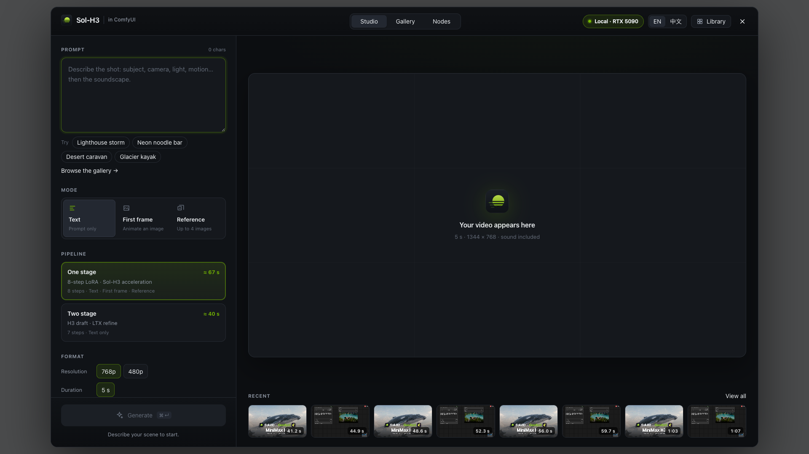
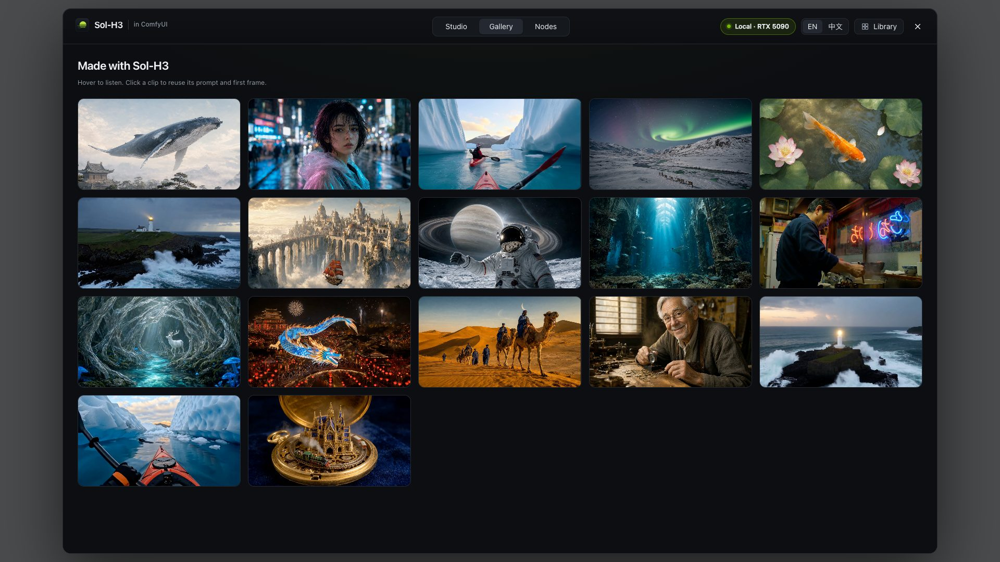

# Sol-H3 in ComfyUI

English · [简体中文](README.zh-CN.md)

**MiniMax-H3 video with sound on one local RTX 5090, in a creative studio inside ComfyUI.**

ComfyUI is the harness. **Sol-H3 Studio** opens over the canvas: write a prompt, choose a mode
and a pipeline, click **Generate**, and watch the progress until the 5-second clip with native
audio plays. Behind it, the Sol engine runs the model in its own process; the node graph is
still there when you want it.

[](https://huggingface.co/datasets/Efficient-Large-Model/Sana-assets/resolve/main/Sol-Engine/Sol-H3-ComfyUI/film/sol-h3-in-comfyui.mp4)

| Studio | Gallery |
|---|---|
|  |  |

## How long does a 5-second clip take?

| One 1344×768 clip, 121 frames with audio · model loaded | Device | Request → MP4 |
|---|---|---:|
| Original MiniMax-H3, 50 steps (BF16) | RTX 5090 | 989.0 s |
| 8-step LoRA (HyperFlow, BF16) | RTX 5090 | 193.6 s |
| **Sol-H3 · one stage** (8-step LoRA, FP8, Sol-Attn, compiled, fast VAE) | RTX 5090 | **67.2 s** |
| **Sol-H3 · two stage** (H3 draft + LTX refine, [`Sol-H3-RTX5090`](../Sol-H3-RTX5090/)) | RTX 5090 | **35.5 s** (27.9×) |
| **Sol-H3 · two stage** ([`Sol-H3-Spark`](../Sol-H3-Spark/)) | DGX Spark | **64.3 s** |

One stage also renders 480p (864×480) in 22.0 s. Timings run from request to the finished MP4
with audio, Qwen text encoding included, through ComfyUI; model loading is reported separately.
The one- and two-stage RTX 5090 rows were measured on an RTX 5090 host with a 90 GB RAM limit;
the DGX Spark row is the released Sol-H3-Spark package (mean of three). Details in
[validation](docs/validation.md).

## What you get

- **Sol-H3 Studio.** A full-screen workspace over ComfyUI, in English or Chinese (switch in
  the header): prompt with examples, mode, pipeline, resolution, seed, live progress
  (encode → step k/8 → decode), the finished video with download, recent videos and a library.
  Switch to **Nodes** at any time; the Studio edits the same graph.
- **Two pipelines.** *One stage* runs MiniMax-H3 with the 8-step [HyperFlow](../HyperFlow/)
  LoRA and Sol-H3's acceleration: LoRA merged into an FP8 DiT, an exact AdaLN lookup table
  instead of 26 GB of projections, Sol-Attn sparse attention with SageAttention for dense steps,
  per-block `torch.compile`, a distilled noncausal VAE. *Two stage* is the
  [`Sol-H3-RTX5090`](../Sol-H3-RTX5090/) H3 draft + LTX refine runtime, used unchanged
  ([`Sol-H3-Spark`](../Sol-H3-Spark/) on DGX Spark).
- **Text, first frame and reference images** (up to four) on one stage.
- **768p or 480p**, 16:9, 5 s.
- **Gallery.** Every showcase clip plays at once on a wall; hover to listen, click to reuse its
  prompt and first frame.
- **Fits a 32 GB card.** The DiT streams block by block; decoders borrow the card only while
  they run; Qwen stays resident and parks in host RAM between requests.
- **Process isolation.** Models run in a worker with its own Python environment, so ComfyUI's
  packages are never touched. Cancel stops the worker.

## Getting started

From weights to the Studio; [docs/install.md](docs/install.md) has every option.

1. **Runtime environment.** Linux, one RTX 5090 (32 GB), ≥ 90 GB host RAM, CUDA 13 driver. One
   Python 3.12 environment with PyTorch 2.12.0+cu130 and Triton 3.7.0 runs Qwen and the H3 DiT;
   add FastVideo + FlashAttention 4 (SM120) and SageAttention 2.2 built for SM120. The one-stage
   engine also needs a small overlay with Diffusers 0.40, PEFT and [`hyperflow_h3`](../HyperFlow/hyperflow_h3/).
2. **Weights.** [MiniMax-H3](https://huggingface.co/MiniMaxAI/MiniMax-H3), the
   [NVFP4 Qwen encoder](https://huggingface.co/Comfy-Org/MiniMax-H3) (`text_encoders/`),
   the [HyperFlow 8-step LoRA](https://huggingface.co/videorebirth/hyperflow), the
   [noncausal VAE](https://huggingface.co/hp-l33/h3-fast-vae-noncausal) and the
   [FastH3 dense-datafree adapter](https://huggingface.co/FastVideo/FastVideo-FastH3-4-step-Preview-v1-LoRA)
   (four-step and baseline profiles).
3. **One-stage checkpoints** (once, on the GPU host; see [install](docs/install.md#one-stage)):
   ```bash
   LORA=minimax_h3_hyperflow_8step_v1.0.safetensors
   python scripts/hyperflow/convert_fp8.py MiniMax-H3/transformer $LORA transformer_hf8
   python scripts/hyperflow/build_adaln_table.py OPTIONS.json t2va.pt T2VA_PAYLOAD.pt
   python scripts/hyperflow/build_adaln_table.py OPTIONS.json fl2va.pt FL2VA_PAYLOAD.pt
   python scripts/hyperflow/merge_adaln_tables.py transformer_hf8/adaln_table.pt t2va.pt fl2va.pt
   python scripts/hyperflow/convert_ref.py \
     https://huggingface.co/MiniMaxAI/MiniMax-H3/resolve/main/transformer_ref \
     $LORA transformer_hf8/adaln_table.pt transformer_ref_hf8    # reference images
   ```
4. **Two stage** (optional): prepare [`../Sol-H3-RTX5090`](../Sol-H3-RTX5090/docs/setup.md); its
   `prepare.py` writes `paths-5090.json`.
5. **Install into ComfyUI** (0.30 or newer) and write the host configuration:
   ```bash
   ln -s "$PWD" /path/to/ComfyUI/custom_nodes/Sol-H3-ComfyUI    # from this directory
   python3 scripts/fetch_assets.py gallery                          # optional showcase wall
   python3 scripts/configure.py \
     --reuse-paths /path/to/h3-runtime/paths.json \
     --dense-lora /path/to/dense-datafree/adapter_model.safetensors \
     --hyperflow-weights /path/to/minimax_h3_hyperflow_8step_v1.0.safetensors \
     --hyperflow-deps /path/to/hyperflow-overlay \
     --hyperflow-fp8-dir /path/to/transformer_hf8 \
     --hyperflow-adaln-table /path/to/transformer_hf8/adaln_table.pt \
     --hyperflow-fast-vae-weights /path/to/fast_h3_vae_noncausal_24l.safetensors \
     --fast-vae-code /path/to/fast-vae-code \
     --hyperflow-ref-fp8-dir /path/to/transformer_ref_hf8 \
     --two-stage-package "$PWD/../Sol-H3-RTX5090" \
     --two-stage-paths /path/to/paths-5090.json \
     --gallery "$PWD/assets/gallery" \
     --output-dir ~/sol-h3-settings --gpu 0
   export SOL_ENGINE_CONFIG=~/sol-h3-settings/config.json
   cd /path/to/ComfyUI && python main.py
   ```
6. **Open the Studio.** It opens with ComfyUI (or **Workflow → Browse Templates → Sol-H3-ComfyUI
   → Sol-H3-Studio**). The first request loads and compiles the models; later requests reuse them.
   `scripts/hyperflow/e2e_comfy.py` times the same graph through ComfyUI's API.

Frontend only: `python3 -m http.server` here and open `scripts/studio_preview.html` (stubbed
backend, no GPU).

## Layout

| Path | Contents |
|---|---|
| `__init__.py`, `sol_h3_engine/comfy_*.py`, `bridge.py`, `config.py` | ComfyUI nodes and `/solh3/*` routes (standard library only), worker bridge, profiles |
| `sol_h3_engine/hyperflow_*.py` | One stage: FP8 linears, AdaLN table, regional compile, the engine |
| `sol_h3_engine/two_stage_worker.py` | Two stage: drives `Sol-H3-RTX5090` / `Sol-H3-Spark` |
| `sol_h3_engine/runtimes/` | NVFP4 Qwen worker and the H3 four-step / 50-step baseline runtimes |
| `web/` | Sol-H3 Studio |
| `scripts/` | `configure.py`, checkpoint builders (`hyperflow/`), `fetch_assets.py`, gallery, local runner |
| `docs/`, `tests/` | Installation, validation, architecture, Studio design; CPU tests |

## Limitations

- 16:9 only, 5 s (121 frames, 24 fps); 768p or 480p on one stage, 768p on two stage.
- Two stage runs text to video; first frame and reference images run on one stage.
- Reference requests swap the DiT checkpoint in host RAM (46–72 s when switching modes).
- One request at a time per GPU; there is no clean-environment installer.
- One stage (FP8, compiled, distilled VAE) is not bit-identical to BF16; it was checked visually.

## Acknowledgements

The Studio follows the pattern of [FreeVideo](https://github.com/FlashML-org/FreeVideo).
HyperFlow is by [Video Rebirth](https://github.com/Video-Rebirth/hyperflow). Model execution
builds on [Diffusers](https://github.com/huggingface/diffusers),
[FastVideo](https://github.com/hao-ai-lab/FastVideo),
[FlashAttention](https://github.com/Dao-AILab/flash-attention) and
[SageAttention](https://github.com/thu-ml/SageAttention). MiniMax-H3 is by MiniMax and is subject
to its own model license. Showcase first frames were made with Qwen-Image-2.1.

## License

Apache-2.0 for the code in this directory ([LICENSE](LICENSE), [NOTICE](NOTICE)); external
components in [UPSTREAM_NOTICES.md](UPSTREAM_NOTICES.md). Model weights and external runtimes
are not included and keep their own terms.
