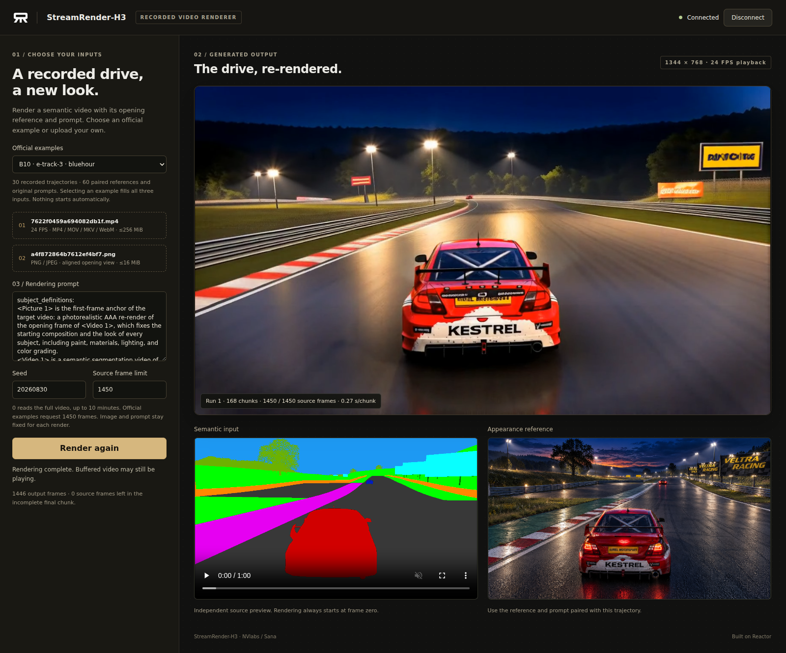

# StreamRender-H3 on Reactor

Render recorded semantic videos with [StreamRender-H3](https://nvlabs.github.io/Sana/Sol-Engine/StreamRender-H3/)
and [Reactor Runtime](https://reactor.inc). Choose an official multi-track example,
or upload a semantic video, its aligned opening reference and a rendering prompt.
The demo streams the generated video at 24 FPS.



## What you can do

- Choose from **60 official input combinations**: 30 recorded semantic trajectories,
  60 reference pictures and their unmodified prompts.
- Upload your own 24 FPS semantic video and aligned reference image.
- Edit the prompt and seed before starting a fresh render.
- Watch output as native chunks finish, with source-frame and output progress.
- Stop generation or render another input combination in the same connection.

Motion and camera movement come from the recorded semantic video. The reference
and prompt determine appearance and stay fixed throughout a render. Input previews
have independent playback controls; seeking a preview does not change generation.
Each render reads the source from frame zero.

## Requirements

The released model supports **4 or 8 GPUs** and uses a four-rank Qwen checkpoint.
The manifest defaults to four B200s; eight B200s are used for local validation.
Allow approximately 274 GB for the checkpoint bundle and reconstructed backbone,
plus image/build caches. The official example bundle adds approximately 1.7 GB.
The demo requires Node 22. Runtime runs in a Docker container with NVIDIA support.

## Prepare weights and start the model

Install the [Reactor CLI](https://docs.reactor.inc). Download the official bundle
to a persistent weights directory:

```sh
hf download Efficient-Large-Model/StreamRender-H3 \
  --revision 9f81b42fb6bac3509ccc6ebf4cb6c8aec7469c62 --local-dir /path/to/weights
python /path/to/weights/download_assets.py
```

Set `runtime.weights_path` in `reactor.yaml` to that directory, then build from
the adapter directory (`reactor/` in Sana or `models/streamrender-h3/` in Cookbook):

```sh
reactor build --no-dockerfile
```

The image needs **2 GB of container shared memory** for the distributed semantic
and video buffers. Configure `/dev/shm` in your deployment before launching it.
The locally tested CLI does not expose that setting; Docker's default 64 MB
causes the first semantic batch to fail. Launch the built image with Docker's
`--shm-size=2g`, your weights mounted at the configured path, and your allocated
GPUs. For the default four-GPU image, a local launch is:

```sh
docker run --rm --gpus '"device=0,1,2,3"' --shm-size=2g \
  -p 8080:8080 -v /path/to/weights:/weights \
  -e REACTOR_WEIGHTS_PATH=/weights -e STREAMRENDER_ASSETS=/weights/assets.json \
  reactor-local/streamrender-h3:dev
```

Use the image name printed by `reactor build` if it differs. The manifest sets
`STREAMRENDER_GPUS=4`; add `-e STREAMRENDER_GPUS=8` and expose eight GPUs for that layout.
Plain `reactor run` with its default shared memory remains an unvalidated launch
path for this model. Wait for the Runtime `/health` endpoint to report `available`.

## Prepare the optional official examples

Use a Sana checkout at revision `62da34b14a53d7289e82fa56692f34e96e089bee`.
Download the [official example media](https://github.com/NVlabs/Sana/releases/tag/streamrender-h3-examples-v1)
into that checkout:

```sh
cd /path/to/Sana/models/streamrender_h3
curl -fL --retry 3 -o streamrender-h3-examples.tar \
  https://github.com/NVlabs/Sana/releases/download/streamrender-h3-examples-v1/streamrender-h3-examples.tar
tar -xf streamrender-h3-examples.tar
```

From the adapter's `demo/` directory:

```sh
npm ci
npm run examples -- /path/to/Sana
npm run dev
```

The preparation script verifies the published sizes and SHA-256 hashes, reads
both official request lists and links or copies the media into the ignored
`demo/public/examples/` directory. These large assets do not belong in Git.
Custom uploads work without installing the example bundle. `npm run build`
includes prepared examples in the static build, if present.

## Use the demo

The service URL defaults to `http://localhost:8080`. Set `VITE_REACTOR_URL` when
starting the frontend to use a different Runtime endpoint. For a production
build, set it when running `npm run build`; Vite embeds that URL in the output.

1. Open the printed frontend URL and click **Connect**.
2. Select an **Official example**, which fills the semantic video, reference
   image and original prompt together. Alternatively, select both local files
   and enter your own prompt. Nothing is selected automatically.
3. Check the input previews. Adjust the seed and **Source frame limit** if needed.
4. Click **Start rendering**. Initial text/image preparation can take 1–2 minutes.
5. Wait for **Rendering complete**. Buffered output may still be playing.
   **Stop rendering** interrupts the run and clears queued playback.
6. Edit the inputs and click **Render again**, or disconnect when finished.

Semantic videos must be self-contained MP4, MOV, MKV or WebM files, at 24 FPS,
up to 256 MiB and 4K. Audio is ignored. References are limited to 16 MiB and
16 megapixels. Use the semantic palette expected by the model and align the
reference to the video's opening frame. An ordinary RGB video is not a semantic
trajectory. The service receives the selected files and prompt when Start is pressed.

The official requests select up to 1450 source frames. A frame limit of `0`
reads the complete video, up to 10 minutes. Decoding preserves frame order and
uses the native replay client's nearest-neighbor resizing. The model determines
the next batch size. A final incomplete batch is discarded, as in the native
replay, and its frame count is reported. No padding, looping or interpolation
is applied. Playback is fixed at 24 FPS; generation can still cause buffer waits.

For SSH access, forward the frontend and Runtime signaling ports. WebRTC also
needs a reachable TURN TCP/TLS relay when direct UDP is unavailable. Forward that
relay's TCP port and use Runtime's supported ICE configuration. Host networking
alone does not forward UDP through SSH. Keep credentials and machine-specific
network settings outside this repository.

## Client contract and implementation

- `start(video, image, prompt, seed, max_frames)` validates the uploads and starts
  a fresh render. File selection or upload alone does not start inference.
- `state_update` reports initialization, consumed source frames, generated frames,
  completed chunks, native scheduling tail, completion and last-chunk duration.
- `stop()` ends the render and clears playback. A fresh `start` begins at frame zero.
- Generated video arrives on `main_video`.

The application decodes one requested CPU batch at a time in
`streamrender_h3_video.py`. `streamrender_h3_model.py` owns the ordered streaming
state; `streamrender_h3_backend.py` reuses Sana's native pipeline without Runtime
imports. `DistributedRunner` owns the existing workers. Source is pinned once
in the manifest; native model code is shared with the upstream implementation.

All 50 DiT layers, two denoising evaluations, native chunk scheduling and history
policy are retained. The diffusion horizon is normalized to floating-point `1.0`
to preserve the intended continuous two-step schedule after JSON loading.
The adapter's playback and decoding do not establish universal visual fidelity:
review each rendered trajectory against its paired input, particularly long runs.

```sh
PYTHONPATH=. python -m pytest tests -q
python -m reactor_runtime.schema --path . --out /tmp/streamrender-schema.json
cd demo
npm test
npm run build
```

## Credits

Thanks to [Rising0321](https://github.com/Rising0321) for porting StreamRender-H3
to Reactor. The model, codecs and example media retain the original authors'
attribution and licenses. See Sana's StreamRender-H3 documentation and the
[example media notes](https://github.com/NVlabs/Sana/blob/sol-engine/models/streamrender_h3/examples/README.md).
